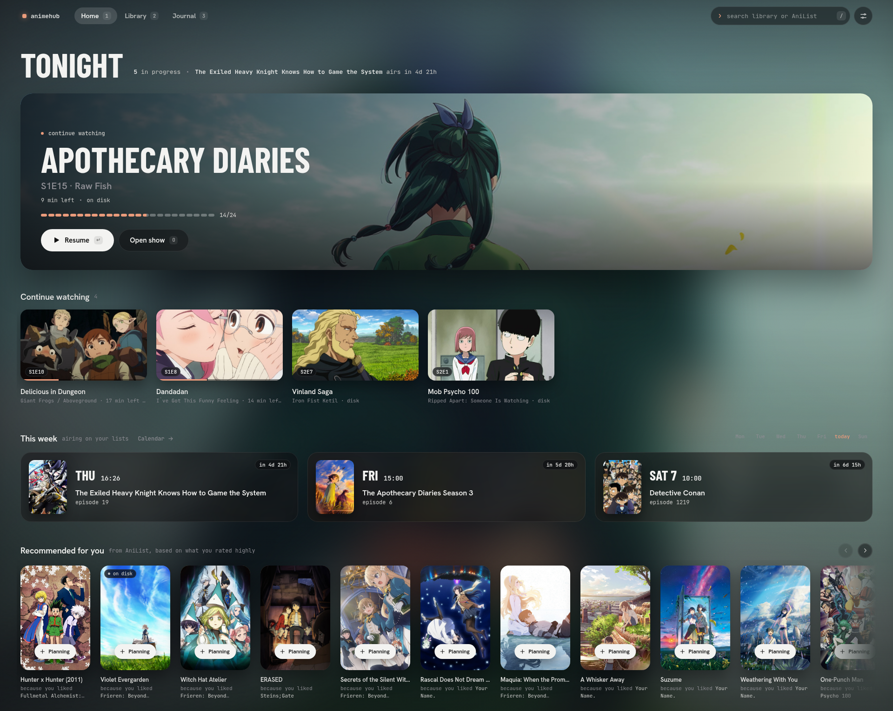
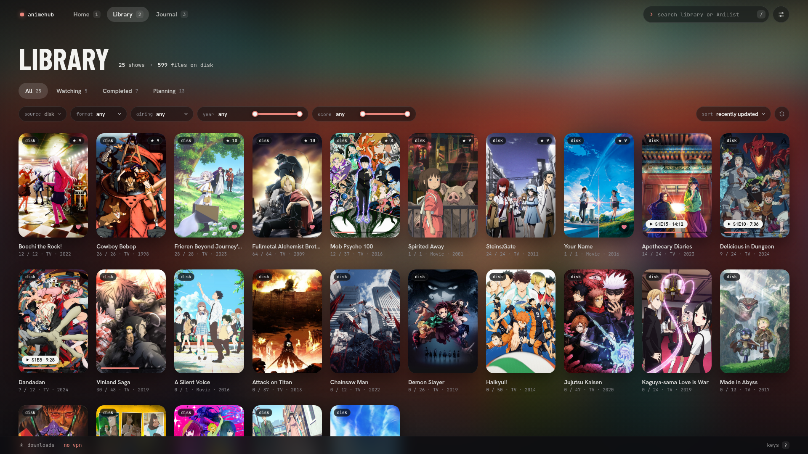
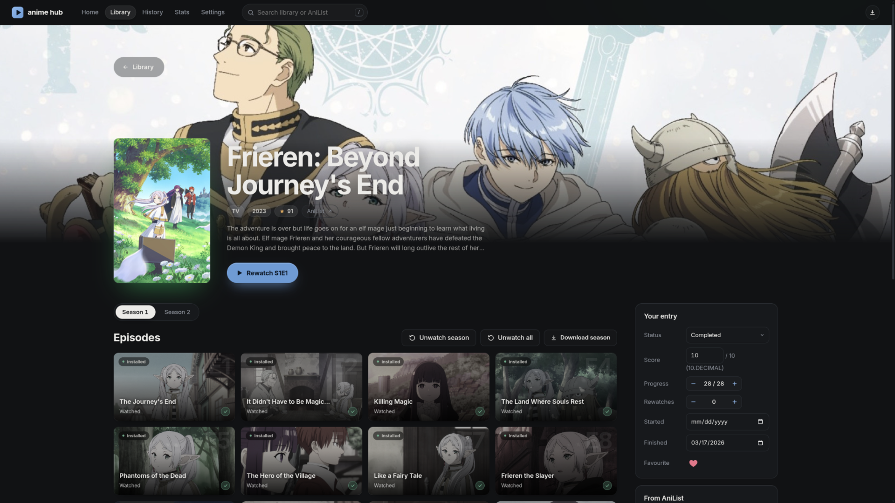
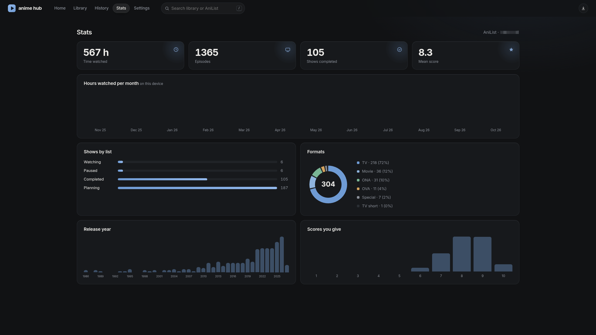
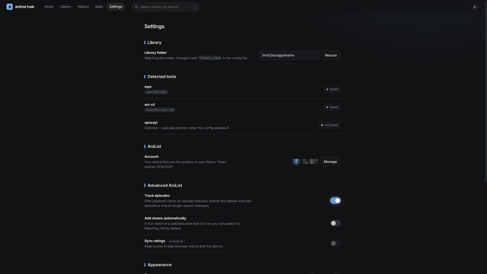

# AnimeHub

A beautiful, local anime library server to display, organize and play animes in mpv.

## Important!
This app is early in development — expect bugs and breaking changes.
## Features

- **Main-page** - Quick resume most recently watched animes and currently airing info.



- **Library** - List all your animes, with extensive filter options.



- **Show-page** - Detail page per anime with play button, episode list, etc.



- **Stats-page** - Per-show time watched, formats, lists, scores and release years.



- **Settings** - Configure AniList integration, appearance, etc.



- **Playback** - episodes open in mpv with resume, auto-play next, progress tracking and a skip-credits hotkey. Your mpv config still works.
- **AniList** - Matches all your animes against AniList to acquire metadata, coverart, etc. and supports rating, progress, etc. editing.
- **Online episodes (optional)** - with [ani-cli](https://github.com/pystardust/ani-cli) installed, every show lists the episodes you don't have as online episodes: click one and it plays in mpv with the same resume, progress tracking, AniList sync and auto-play as local files, or download it straight into your library folder. Shows are matched automatically; "Wrong episodes?" on a show page fixes a bad match.

## Requirements

- Linux
- Python 3.9+ (standard library only, nothing to install)
- mpv
- A Chromium-family browser (chromium, chrome,brave, or edge)
- rust/cargo
- An AniList account (optional)
- ani-cli (optional, for streaming and downloads)

## Run

```sh
git clone https://github.com/Elias8832/AnimeHub.git
cd AnimeHub/desktop
cargo build --release
./install.sh
```

The server starts on `http://127.0.0.1:8787`.

## Configuration

`~/.config/anime-hub/config.json` (honours `XDG_CONFIG_HOME`; override
with `--config FILE`). All keys optional, a broken file only warns:

```json
{
  "library_root": "~/Videos/Anime",
  "port": 8787,
  "data_dir": null,
  "window": "app"
}
```

| Key | Meaning |
| --- | --- |
| `library_root` | the folder anime-hub watches for video files (also set from Settings → Library) |
| `port` | server port (default `8787`) |
| `data_dir` | database and cache location (default `~/.local/share/anime-hub`, honours `XDG_DATA_HOME`) |
| `window` | `"app"` (default, standalone Chromium window), `"browser"` (tab), `"none"` (server only; `--no-browser` forces it for one run) |

Changing `library_root` never deletes anything: the app reports the
different folder and waits for you to connect it explicitly.

## Data

All state lives in `data_dir` (default `~/.local/share/anime-hub`):
`hub.db` (watch state, metadata, history), `cache/` (artwork),
`anilist_token.json` (OAuth token). Plain files; deleting the directory
is a full reset.

## Roadmap

- **v0.1** — local library, AniList sync, stats, desktop wrapper.
- **v0.2 (in progress)** — streaming and downloads delegated to your own installed [ani-cli](https://github.com/pystardust/ani-cli) (the app contains no provider code and fetches no video itself) and a unified local/streaming episode list are in; better tools for unmatched shows are next.
- **Later** — multiple library roots, per-show path
  overrides.

## AI-notice

- Anime-hub was made with a lot of help of mainly GLM 5.3 Flash and very little help of Sonnet 5.5.
- I want to make clear that the use of LLMs did not steal anyones job in this case, Anime-hub simply wouldn't exist without it, as I would have never started this project to begin with.
- I **DID NOT** give a large LLM 200$, a prompt and a couple hours. I made this project step by step, this is my app that I build with passion over many many hours and i want to continue working on it.

## Streaming/downloading/hosting/etc.-notice

- Anime-hub **does not contain any streaming, downloading or hosting of animes**, nor does it bundle any provider code or third-party content. It is a local library manager: it plays video files you already own, and pulls metadata and artwork from AniList.
- The optional streaming and downloads are done entirely by your own installed ani-cli. Anime-hub only starts it (answering its menus itself) and hands mpv its progress-tracking socket; it never contacts a video site.

## License

GPL-3.0. See [LICENSE](LICENSE).

## Credits

- Metadata, artwork and airing times from [AniList](https://anilist.co).
  Unofficial; not affiliated with AniList.
- Playback by [mpv](https://mpv.io).
