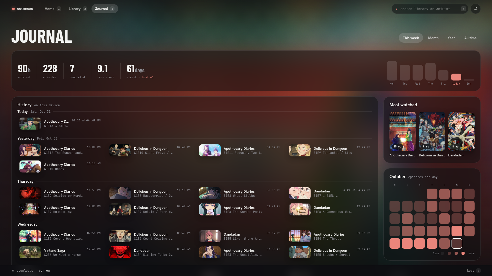

# AnimeHub

A beautiful, local anime library to organize your shows and play them in mpv.
Works with your AniList account: what you watch is synced back to it.

## Important!
This app is early in development — expect bugs and breaking changes.
## Features

- **Home** - Up next, continue watching, this week's new episodes and recommendations.


- **Library** - All your shows, with lots of filters. Anything it couldn't match lands in "Needs a look".


- **Show page** - One page per franchise: every season, movie and special, plus your AniList entry.


- **Journal** - Your history and stats on one page: what you watched when, totals, most watched, genres and more.



- **Settings** - AniList, library, playback, online episodes and appearance.


- **Playback** - Episodes open in mpv, with resume, auto-play next and progress tracking. Your mpv config still works.
  - Skip openings and endings with Enter, or automatically. Uses the file's chapters ("Opening", "ED"…).
  - Optional [AniSkip](https://aniskip.com) for files without chapters. Off by default: AniSkip sees which episode you start.
- **Search and keys** - `/` searches your library, AniList, settings and commands. `?` lists all keyboard shortcuts.
- **AniList** - Matches your shows to AniList for info and artwork. Edit your score, progress and status right in the app.
- **Online episodes (optional)** - With [ani-cli](https://github.com/pystardust/ani-cli) installed, episodes you don't have show up as online episodes.
  - They play in mpv with the same resume, tracking, AniList sync and auto-play as your files.
  - Or download them straight into your library folder.
  - A wrong match? "Wrong episodes?" on the show page fixes it.

## Requirements

- Linux, or Windows 10/11 (experimental, see [Windows](#windows-experimental))
- Python 3.9+ (standard library only, nothing to install; the Windows zip brings its own)
- mpv
- A Chromium-family browser (chromium, chrome, brave, or edge)
- rust/cargo (only to build the desktop app or the AppImage)
- An AniList account (optional)
- ani-cli (optional, for streaming and downloads)

## Run

Quickest way to try it, nothing to build:

```sh
git clone https://github.com/Elias8832/AnimeHub.git
cd AnimeHub
python3 hub.py
```

It opens in a Chromium app window (or a browser tab). The server runs on `http://127.0.0.1:8787`.

### Desktop app

Its own window and an app-menu entry; closing the window quits the app. Needs rust/cargo:

```sh
git clone https://github.com/Elias8832/AnimeHub.git
cd AnimeHub/desktop
cargo build --release
./install.sh
```

### AppImage (any distro, no building)

One file that runs on any Linux distro. Download `AnimeHub-x86_64.AppImage` from the
[Releases page](https://github.com/Elias8832/AnimeHub/releases), then:

```sh
chmod +x AnimeHub-x86_64.AppImage
./AnimeHub-x86_64.AppImage
```

It still uses your system's Python 3.9+, mpv, Chromium-family browser and ani-cli. A tool like
[Gear Lever](https://github.com/mijorus/gearlever) adds it to your app menu.
`AnimeHub-x86_64.AppImage --hub` starts only the server (add `--no-browser` for no window).

To build it yourself (needs rust/cargo): `desktop/appimage/build.sh`.

### Windows (experimental)

Windows 10 or 11, 64-bit. Python comes inside the zip, and the window is a Microsoft Edge
app window (Chrome or Brave are used first if installed).

1. Download `AnimeHub-windows-x64.zip` from the
   [Releases page](https://github.com/Elias8832/AnimeHub/releases).
2. Unzip it anywhere (for example to your Documents). Keep the `AnimeHub` folder together:
   `AnimeHub.exe` needs the `python` and `app` folders next to it.
3. Install mpv, and for online episodes ani-cli. In PowerShell, install
   [Scoop](https://scoop.sh) (skip if you have it), then the tools. ani-cli is a bash script
   and runs in Git for Windows' bash:

   ```powershell
   Set-ExecutionPolicy -ExecutionPolicy RemoteSigned -Scope CurrentUser
   Invoke-RestMethod -Uri https://get.scoop.sh | Invoke-Expression
   winget install Git.Git
   scoop bucket add extras
   scoop install ani-cli yt-dlp    # brings mpv too; only local files: scoop install extras/mpv
   ```

4. Double-click `AnimeHub.exe`. The exe isn't signed, so the first time Windows may say
   "Windows protected your PC": click "More info", then "Run anyway".
   Closing the window quits the app.

Settings are in `%APPDATA%\anime-hub\config.json`, data in `%LOCALAPPDATA%\anime-hub`.
If it doesn't start, `%LOCALAPPDATA%\anime-hub-wrapper\` has `hub.log` and `wrapper.log`.
To build the zip yourself (needs rust/cargo, and binutils for the icon):
`powershell -ExecutionPolicy Bypass -File desktop\windows\build.ps1`.

### Updating

- From git: `git pull`. Desktop app: then `cargo build --release && ./install.sh` again.
- AppImage / Windows zip: download the new one (Windows: replace the whole folder).

Your data is kept.

## Library folders

Point AnimeHub at one folder (Settings → Library). It understands the usual layouts:

```
Anime/
├── Frieren/                     one folder per show
│   ├── Season 1/                seasons as "Season N" (or "Part N")
│   │   └── Frieren - 01.mkv
│   └── Specials/                "Specials" / "OVA"
├── Cowboy Bebop/
│   └── [Group] Cowboy Bebop - 01 (1080p).mkv
└── Movies/
    └── Your Name/Your Name.mkv  movies in a "Movies" folder
```

Episode numbers are read from names like `S01E05`, `E05`, `Episode 5` or `Title - 05`.
Files are never renamed or moved.

## Configuration

`~/.config/anime-hub/config.json` (Windows: `%APPDATA%\anime-hub\config.json`; or `--config FILE`). Every key is optional:

```json
{
  "library_root": "~/Videos/Anime",
  "port": 8787,
  "data_dir": null,
  "window": "app"
}
```

| Key | Meaning |
| --- | --- |
| `library_root` | the folder AnimeHub watches for video files (also set from Settings → Library) |
| `port` | server port (default `8787`) |
| `data_dir` | database and cache location (default `~/.local/share/anime-hub`, honours `XDG_DATA_HOME`) |
| `window` | `"app"` (own window, default), `"browser"` (tab) or `"none"` (server only) |
| `anilist_client_id` | your own AniList app id; only needed if you change `port` |
| `remote_hosts` | extra host names for opening it from your phone through a proxy, e.g. `["pc.tailnet.ts.net"]` with `tailscale serve --bg --https=8443 8787` |

Changing `library_root` never deletes anything. The app asks before it switches.

## Data

Everything lives in `data_dir` (default `~/.local/share/anime-hub`, Windows: `%LOCALAPPDATA%\anime-hub`):

- `hub.db` — watch state, info, history
- `cache/` — artwork
- `anilist_token.json` — your AniList login
- `anilist_activity.json` — your AniList activity, for the Journal
- `recommendations.json`

Deleting the folder is a full reset.

## Privacy and security

- **No tracking.** No accounts, no ads, no analytics. Your data stays on your PC.
- **Only your PC can open it.** The server only listens locally and turns away requests from other websites.
- **No password.** If you open it to your phone (`remote_hosts`), everyone on that network can use it.
- **Your AniList login** is a token in `anilist_token.json`, readable only by your user (Windows: it sits in your own user profile).
- **What it talks to on the internet:**
  - [AniList](https://anilist.co) — metadata, artwork and your list (when connected)
  - [ani.zip](https://api.ani.zip) — episode titles and pictures
  - [AniSkip](https://aniskip.com) — only if you turn it on (off by default); it sees which episode you start
  - with online episodes, your own ani-cli contacts the streaming site; the app warns you when no VPN is on

## Roadmap

Only the big releases. Nothing is set in stone.

- **v0.1** (done)— local library, AniList sync, stats, desktop wrapper.
- **v0.2** (done) — online episodes and downloads through your own [ani-cli](https://github.com/pystardust/ani-cli), one episode list for both.
- **v0.25** (done) Focus on Quality of Life changes and bug fixes.
- **v0.3** (done) — complete redesign, much faster, Journal, recommendations, skip openings/endings, AppImage.
- **Later** — multiple library roots

## AI-notice

- AnimeHub was made with a lot of help from mainly GLM 5.3 Flash, and very little help from Sonnet 5.5.
- I want to make clear that using LLMs didn't take anyone's job here. AnimeHub simply wouldn't exist without them, because I would never have started this project.
- I **DID NOT** give a large LLM $200, a prompt and a couple of hours. I built this project step by step. This is my app, built with passion over many, many hours, and I want to keep working on it.

## Streaming/downloading/hosting/etc.-notice

- AnimeHub **contains no streaming, downloading or hosting of anime**, and no provider code.
- It plays files you already own and gets info and artwork from AniList.
- Online episodes and downloads are done by your own ani-cli. AnimeHub only starts it; it never contacts a video site itself.

## License

GPL-3.0. See [LICENSE](LICENSE).

## Credits

- Info, artwork, airing times and recommendations from [AniList](https://anilist.co). Unofficial; not affiliated with AniList.
- AnimeHub is a player for your files, not a list or tracking service. Your list lives on AniList.
- AniList data is kept on your PC only to show it, never as a backup. Free and non-commercial, following the [AniList API terms](https://docs.anilist.co/guide/terms-of-use).
- Playback by [mpv](https://mpv.io).
