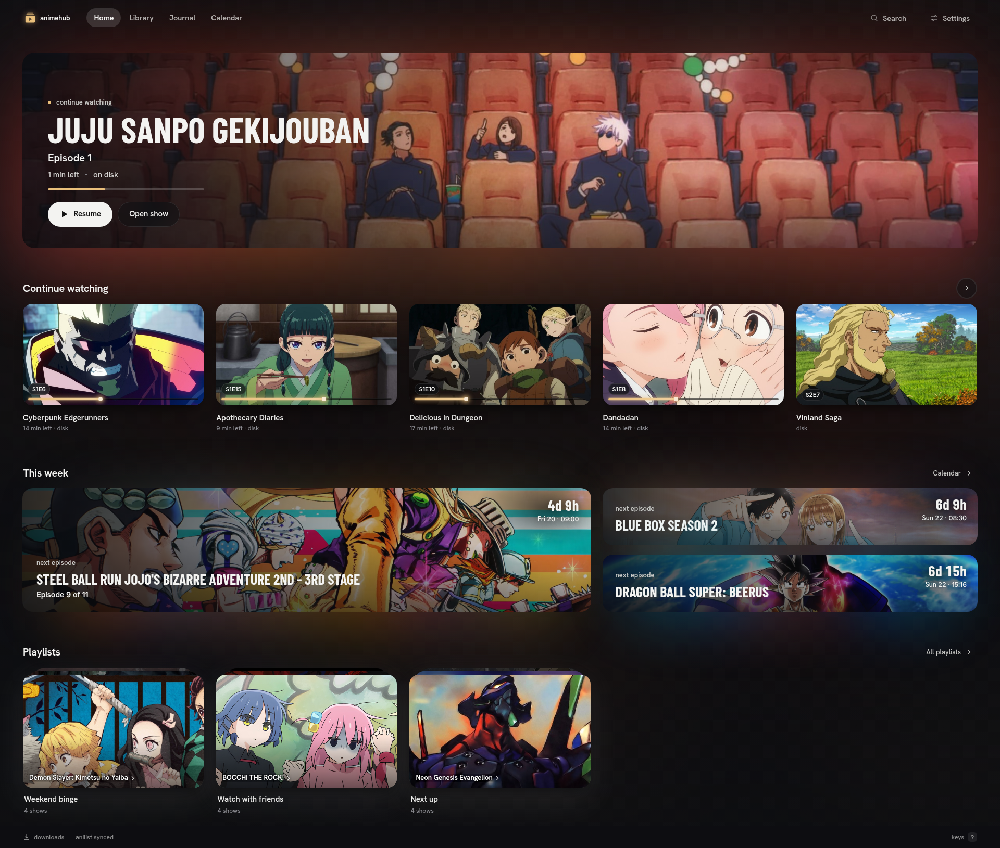
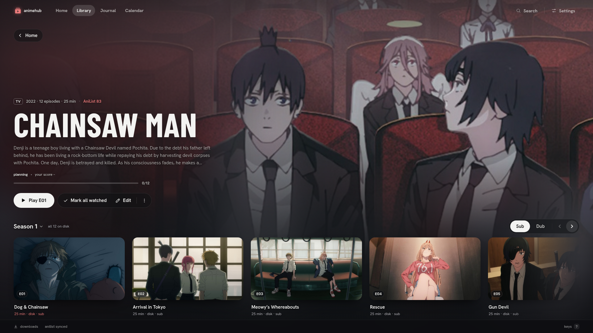
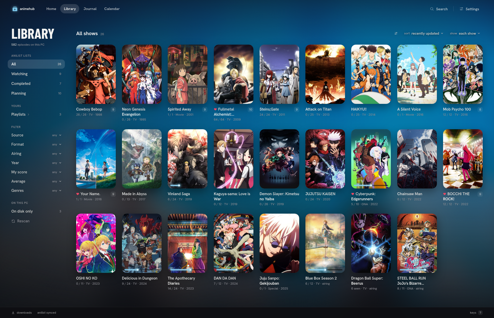
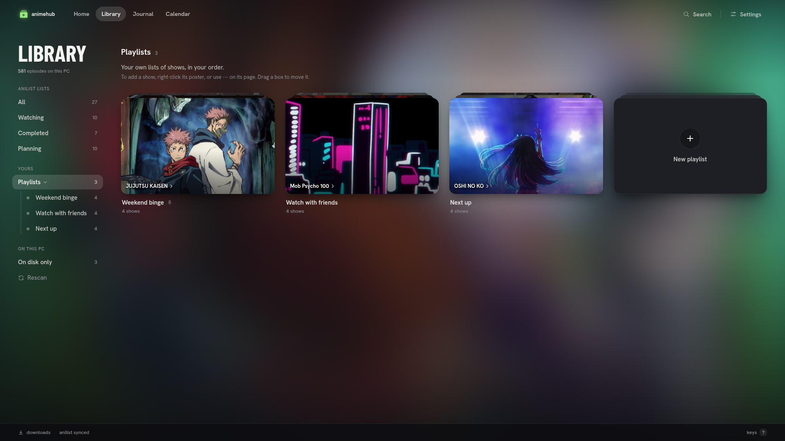
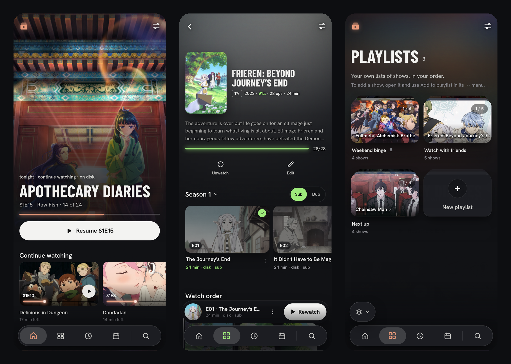

This app is in somewhat early development - expect bugs and breaking changes. **[Feedback is appreciated](https://github.com/Elias8832/AnimeHub/issues)**
# AnimeHub

Everything you need to watch anime in one app:

- Desktop/Android (any phone as a remote)

- Files/Online (with [ani-cli](https://github.com/pystardust/ani-cli))

- AniList/MyAnimeList

- mpv pre-configured/own configuration

- Calendar/Journal

- VPN warnings

# **[See screenshots](#screenshots)**

## Install

### Unstable/Stable Versions

**Select in Releases**

- ***Stable*** is more ***tested***
- ***Unstable*** has the ***newest*** features, but is likelier to ***break***

- [Linux](#linux)
- [Windows](#windows)
- [Android](#android)

## Linux

**Required (Git and AppImage)**:
- Python 3.9+ (often preinstalled)
- Chromium-family browser (Chrome, Brave, Edge, Chromium)

**Git** (needs rust/cargo):

1. Open terminal and paste this:

```sh
git clone https://github.com/Elias8832/AnimeHub.git
cd AnimeHub/desktop
cargo build --release
./install.sh
```

2. Installed, open it like any other app

**AppImage:**

1. **Download** `AnimeHub-x86_64.AppImage` from the [Releases page](https://github.com/Elias8832/AnimeHub/releases)
2. Open terminal and paste this

```sh
cd ~/Downloads
chmod +x AnimeHub-x86_64.AppImage
./AnimeHub-x86_64.AppImage
```

3. Installed, **BUT** apps like [GearLever](https://flathub.org/apps/it.mijorus.gearlever) are suggested to make it appear in searches and app lists

## Windows

1. **Download** `AnimeHub-windows-x64.zip` from the [Releases page](https://github.com/Elias8832/AnimeHub/releases)
2. **Unzip** it anywhere
3. **Windows will warn you that the app is dangerous on the next step**, that is not true, I am just not willing to pay $100
4. **Double-click** `AnimeHub.exe` 
5. **Click** "More info"
6. **Click** "Run anyway"
7. Installed, open it like any other app

## Android

**Important**, following install will be different for everybody and on some phones specific security settings will need to be turned off, but something like this:

**Required**
- **Termux** for online episodes (download from **[F-Droid](https://f-droid.org/packages/com.termux/)**, the Play Store version is too old, install is similar to AnimeHub)

1. **Download** `AnimeHub-android.apk` from the [Releases page](https://github.com/Elias8832/AnimeHub/releases)
2. **Open** it
3. **Click** through any warnings
4. **Click** Install
5. Installed, open it like any other app

## Your files

One folder per show. AnimeHub finds seasons, movies and episode numbers by itself, and never renames or moves anything.

- [How to name folders](#library-folders)

## Privacy

- Open source
- No tracking
- No accounts
- No ads
- Everything is yours
- Everything stays with you
- VPN warning before online episodes
  
- [In detail](#privacy-expanded)

## AI-notice

- AnimeHub was made with a lot of care, time and passion, but it has to be noted that I would not have made this app without LLMs. I want to make clear that the usage of LLMs in this project:

- ***DID NOT***  steal anyone's job
- ***WASN'T***  specifically told to copy anything
- ***DID NOT***  create artwork or similar

- I solely used it for turning ***MY IDEAS*** into reality, over more than a month, and I want to continue refining it and adding new features, especially if people are interested

## Library-Folders

One folder per show. Seasons, extras and movies get their own folders inside it, or the files sit right in the show folder.

```
Anime/
├── Jujutsu Kaisen/
│   ├── Season 1/
│   │   ├── Jujutsu Kaisen - S01E01.mkv
│   │   └── Jujutsu Kaisen - S01E02.mkv
│   ├── Season 2/
│   ├── Specials/
│   └── Movies/
└── Chainsaw Man/
    ├── Chainsaw Man - 01.mkv
    └── Chainsaw Man - 02.mkv
```

- **Seasons:** `Season 1` or `Part 1`
- **Extras:** `Specials` or `OVA`
- **Movies:** `Movies`
- **Episode numbers:** names like `S01E05`, `E05`, `Episode 5` or `Title - 05`

## Privacy-Expanded

### Internet:
- [AniList](https://anilist.co): info, art, your list.
- [ani.zip](https://api.ani.zip): episode titles and pictures.
- [MyAnimeList](https://myanimelist.net): your list, only if you connect it.
- [AniSkip](https://aniskip.com): only if you turn it on, skipping times

### GitHub

- The list of all anime titles, for typo-proof search. On your first AniList search, then every two weeks. 6 MB (62 MB on Windows).
- Getting or updating ani-cli.
- Checking for new versions: on a click, or once a day if you say yes. You can allow this only while a VPN is on.

### Windows-setup

- on your click, [Scoop](https://scoop.sh) and the programs it installs.

### Online-episodes

- Are handled solely through ani-cli, AnimeHub does not contain any code for scraping, or similar! The app warns you when no VPN is on. Without a click, it contacts the site only while a VPN is on: to link a show, refresh its episode list or get the next episode ready. To allow these without a VPN, turn off _Online episodes and downloads_ in Settings → Privacy & VPN; this also stops the warning.

### Phone-sync

- The Android app talks straight to the PC you paired it with, over your own network. No server in between, and nothing about the sync goes to AniList.

## Streaming/downloading/hosting/etc.-notice

- AnimeHub **contains no streaming, downloading or hosting of anime**, and no provider code.
- It plays files you already own and gets info and artwork from AniList.
- Online episodes and downloads are done by your own ani-cli. AnimeHub only starts it; it never contacts a video site itself.

## License

GPL-3.0. See [LICENSE](LICENSE).

## Credits

- Info, artwork, airing times and recommendations from [AniList](https://anilist.co). Unofficial; not affiliated with AniList.
- AnimeHub is a player for your files, not a list or tracking service. Your list lives on AniList or MyAnimeList.
- MyAnimeList lists, progress and scores through the [MyAnimeList API](https://myanimelist.net/apiconfig/references/api/v2). Unofficial; not affiliated with MyAnimeList.
- AniList data is kept on your PC only to show it, never as a backup. Free and non-commercial, following the [AniList API terms](https://docs.anilist.co/guide/terms-of-use).
- Typo-proof search uses the [anime-offline-database](https://github.com/manami-project/anime-offline-database) by manami-project, under the [ODbL 1.0](https://opendatacommons.org/licenses/odbl/1-0/) / [DbCL 1.0](https://opendatacommons.org/licenses/dbcl/1-0/). Only its titles and AniList links are kept.
- Playback by [mpv](https://mpv.io).
- Online episodes and downloads by your own [ani-cli](https://github.com/pystardust/ani-cli).
- The Android app runs the same Python code through [Chaquopy](https://chaquo.com/chaquopy/) (MIT) and starts ani-cli through [Termux](https://termux.dev). Python's and Chaquopy's licence texts ship inside the app.
- Sharper banners by [Upscayl](https://upscayl.org), if you install it.
- Playlist icons: [Lucide](https://lucide.dev), ISC licence (text in `web/icons/LICENSE-lucide.txt`).
- Fonts: [Hanken Grotesk](https://github.com/marcologous/hanken-grotesk), [Inter](https://github.com/rsms/inter) (its digits), [JetBrains Mono](https://github.com/JetBrains/JetBrainsMono) and [Barlow Condensed](https://github.com/jpt/barlow), all under the SIL Open Font License 1.1 (licence texts in `web/fonts/`). `mpv/fonts/` holds the same fonts as plain TTF files for the player's controls.

## Screenshots









# [To the Top](#animehub)
